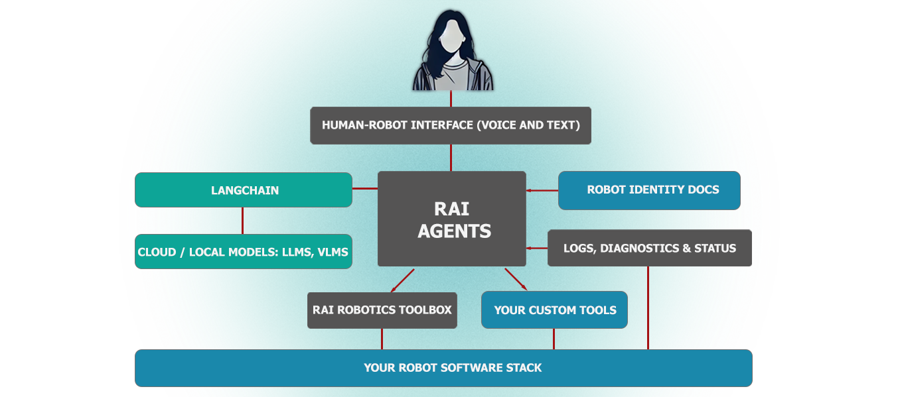

# RAI

RAI is an agent framework for robots. It connects LLM agents to ROS 2: agents read sensors, call services and run actions through tools, talk with people by text or voice, and every action passes safety hooks that fail closed.

Documentation: [robotecai.github.io/rai](https://robotecai.github.io/rai/)

<div align="center">



[](https://opensource.org/licenses/Apache-2.0)

[](https://codecov.io/gh/RobotecAI/rai)
[](https://arxiv.org/abs/2505.07532)


[](https://discord.gg/3PGHgTaJSB)

</div>

## Quick start

With ROS 2 Lyrical or Jazzy sourced:

```bash
python3 -m venv --system-site-packages .venv && source .venv/bin/activate
pip install "rai-core[openai]"
export OPENAI_API_KEY="sk-..."
```

```python
import asyncio

from rai.agents import ReActAgent
from rai.communication.ros2 import ROS2Connector
from rai.tools.ros2 import ROS2Toolkit

with ROS2Connector() as connector:
    agent = ReActAgent("complex", ROS2Toolkit(connector=connector).get_tools())
    print(asyncio.run(agent.ainvoke("Which topics are available?")).text)
```

Next: [install](https://robotecai.github.io/rai/getting_started/install/), [your first agent](https://robotecai.github.io/rai/getting_started/first_agent/), [configuration](https://robotecai.github.io/rai/getting_started/configuration/). To work on RAI itself, see the [developer environment](https://robotecai.github.io/rai/getting_started/dev_env/).

## Packages

| Package                                             | Purpose                                                                                     |
| --------------------------------------------------- | ------------------------------------------------------------------------------------------- |
| [rai_core](src/rai_core)                            | Agents, tools, ROS 2 connectors, safety hooks, MCP, robot manifest, flight recorder, replay |
| [rai_s2s](src/rai_s2s)                              | Speech recognition, text to speech and voice agents                                         |
| [rai_whoami](src/rai_whoami)                        | Robot identity from documentation, images and URDFs                                         |
| [rai_perception](src/rai_extensions/rai_perception) | Open-set detection and segmentation                                                         |
| [rai_semap](src/rai_semap)                          | Semantic map of detected objects                                                            |
| [rai_sim](src/rai_sim), [rai_bench](src/rai_bench)  | Simulator bridges and benchmarks                                                            |
| [rai_finetune](src/rai_finetune)                    | Fine-tuning on embodied data (experimental)                                                 |

## Demos

| Application                                | Robot                    | Docs                                                            |
| ------------------------------------------ | ------------------------ | --------------------------------------------------------------- |
| Mission and obstacle reasoning in orchards | Autonomous tractor       | [link](https://robotecai.github.io/rai/demos/agriculture/)      |
| Manipulation tasks with natural language   | Robot arm (Franka Panda) | [link](https://robotecai.github.io/rai/demos/manipulation/)     |
| Autonomous mobile robot                    | Husarion ROSbot XL       | [link](https://robotecai.github.io/rai/demos/rosbot_xl/)        |
| Agentic mobile manipulator                 | RB-KAIROS                | [link](https://github.com/RobotecAI/agentic-mobile-manipulator) |

## Community

RAI is one of the projects of the [Embodied AI Community Group](https://github.com/ros-wg-embodied-ai); its meetings are in the [ROS Community Calendar](https://calendar.google.com/calendar/u/0/embed?src=c_3fc5c4d6ece9d80d49f136c1dcd54d7f44e1acefdbe87228c92ff268e85e2ea0@group.calendar.google.com&ctz=Etc/UTC). Ask questions in [Q&A](https://github.com/RobotecAI/rai/discussions/categories/q-a) or on [Discord](https://discord.gg/3PGHgTaJSB). Contributions are welcome: see the [contribution guide](CONTRIBUTING.md).

A talk about [RAI at ROSCon 2024](https://vimeo.com/1026029511).

## Citation

```bibtex
@misc{rachwał2025raiflexibleagentframework,
      title={RAI: Flexible Agent Framework for Embodied AI},
      author={Kajetan Rachwał and Maciej Majek and Bartłomiej Boczek and Kacper Dąbrowski and Paweł Liberadzki and Adam Dąbrowski and Maria Ganzha},
      year={2025},
      eprint={2505.07532},
      archivePrefix={arXiv},
      primaryClass={cs.MA},
      url={https://arxiv.org/abs/2505.07532},
}
```
