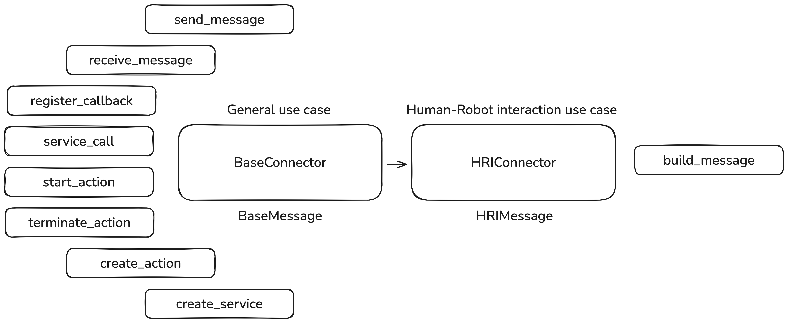

# Connectors

Connectors are a set of abstract interfaces and implementations designed to provide a unified way to
interact with various communication systems, including robot middleware like ROS2, sound devices,
and other I/O systems.

## Connector Architecture

Each transport has its own connector classes. They share no base class: a ROS 2 connector speaks native ROS 2 messages, an HRI connector speaks `HRIMessage`s.

### Interfaces

#### HRIConnector

??? info "HRIConnector and HRIMessage definitions"

    ::: rai.communication.hri_connector.HRIConnector

    ::: rai.communication.hri_connector.HRIMessage

A protocol for Human-Robot Interaction transports (`send`, `subscribe`, `close`) of `HRIMessage`s:

-   Multimodal messages: text, `rai.content.Image`s and `rai.content.Audio`
-   Message sequencing and conversation IDs
-   No LLM framework types: agents convert messages at the LLM boundary (`rai.messages`)

### Concrete Implementations

| Connector        | Description                          | Documentation Link                       |
| ---------------- | ------------------------------------ | ---------------------------------------- |
| ROS 2 Connectors | Robot Operating System 2 integration | [ROS2 Connectors](./ROS_2_Connectors.md) |

## Key Features

### Message Types

-   **ROS 2 messages**: `ROS2Connector` takes and returns the native message, service and action types
-   **HRIMessage**: Multimodal message with text, images, and audio

### Communication Patterns

`ROS2Connector` methods are async; `connector.sync` has blocking twins of `publish`, `receive`, `call`, `send_goal` and `transform`.

1.  **Publish/Subscribe**

    -   `publish(topic, msg, qos=...)`: Publish a message
    -   `receive(topic, timeout=..., max_age=...)`: The latest message on a topic
    -   `subscribe(topic, callback=None)`: A `Subscription`, delivered to the callback or iterated

2.  **Request/Response**

    -   `call(service, request, timeout=...)`: Call a service and return its response
    -   `create_service(name, on_request, service_type=...)`: Serve a service

3.  **Actions**

    -   `send_goal(action, goal, on_feedback=..., on_done=...)`: A `GoalHandle` with `result()`, `feedback()` and `cancel()`
    -   `create_action(name, execute, action_type=...)`: Serve an action

## Threading Model

-   ROS 2 connectors share a runtime with one node, one executor and one spin thread
-   User callbacks run off the executor thread, one at a time per subscription, in arrival order
-   `close()` (or leaving a `with` block) fails pending calls with `ConnectorClosedError` and destroys the entities

## Usage Examples

| Connector | Example Usage Documentation                            |
| --------- | ------------------------------------------------------ |
| ROS 2     | [ROS2 Connectors](./ROS_2_Connectors.md#example-usage) |

## Error Handling

-   Every wait has a timeout and raises `ROS2TimeoutError` (a `TimeoutError`) when it expires
-   Calls on a closed connector raise `rai.communication.ConnectorClosedError`
-   An exception in a user callback is logged and never stops message delivery

## See Also

-   [Agents](../agents/overview.md): For more information on the different types of agents in RAI
-   [Aggregators](../aggregators/overview.md): For more information on the different types of aggregators in RAI
-   [Langchain Integration](../langchain_integration/overview.md): For more information on the LangChain integration within RAI
-   [Multimodal messages](../langchain_integration/multimodal_messages.md): For more information on the multimodal LangChain messages in RAI
-   [Runners](../runners/overview.md): For more information on the different types of runners in RAI
