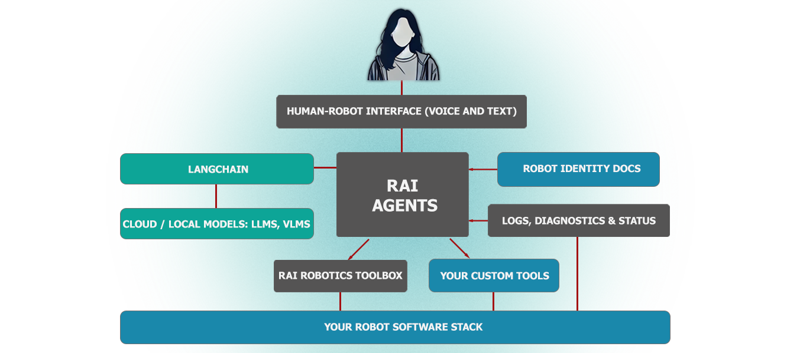

# RAI

RAI is an agent framework for robots. It connects LLM agents to ROS 2: agents read sensors, call services and run actions through tools, talk with people by text or voice, and every action passes safety hooks that fail closed.



<div style="text-align: center;">
    <a href="https://opensource.org/licenses/Apache-2.0"></a>
    <a href="https://github.com/RobotecAI/rai/releases"></a>
    <a href="https://arxiv.org/abs/2505.07532"></a>
    
    
    <a href="https://discord.gg/3PGHgTaJSB"></a>
</div>

## What RAI gives you

-   **Agents**: tool-calling `ReActAgent` and `StateBasedAgent` (which sees the robot's current state on every model call), on LangChain, with an explicit lifecycle and a typed event stream.
-   **ROS 2 connectors**: an async `ROS2Connector` with sync twins for topics, services, actions and TF, native messages and zero-copy numpy views of images and point clouds.
-   **Tools**: generic ROS 2, Nav2, manipulation and diagnostics tools, each with an effect (READ, WRITE, ACTUATE) and its ROS targets.
-   **Safety**: hooks on every tool call and on every publish, service call and goal, with an e-stop you can trigger from ROS, opt-in confirmation, rate limits and an audit log.
-   **Interfaces**: speech to speech, a Streamlit chat, and an MCP server that gives any MCP client the robot's tools.
-   **Robot knowledge**: a manifest of what the robot is and what its ROS graph offers, and robot identity from documentation (rai_whoami).
-   **Testing**: an MCAP flight recorder of agent runs next to ROS topics, and replay of recordings in CI without a robot.

## Supported platforms

| ROS 2             | Ubuntu | Python | Architecture |
| ----------------- | ------ | ------ | ------------ |
| Lyrical (primary) | 26.04  | 3.14   | amd64        |
| Jazzy             | 24.04  | 3.12   | amd64        |

Agents, tools, settings and content types also work without ROS 2.

## Where to start

-   [Install](getting_started/install.md) RAI, then build [your first agent](getting_started/first_agent.md).
-   [Configure](getting_started/configuration.md) models: OpenAI, Anthropic, Google, AWS Bedrock, Ollama or any OpenAI-compatible server.
-   Read the [architecture](concepts/overview.md) to see how the pieces fit.
-   Try a [demo](demos/overview.md): a robotic arm, a mobile robot, an autonomous tractor.
-   [What's new in 3.0](whats_new.md).

## Community

RAI is one of the projects of the [Embodied AI Community Group](https://github.com/ros-wg-embodied-ai). Ask questions on [Discord](https://discord.gg/3PGHgTaJSB) or in [GitHub discussions](https://github.com/RobotecAI/rai/discussions/categories/q-a). See the [FAQ](faq/faq.md) and the [contribution guide](faq/contributing/CONTRIBUTING.md).

## Citation

```bibtex
@misc{rachwał2025raiflexibleagentframework,
      title={RAI: Flexible Agent Framework for Embodied AI},
      author={Kajetan Rachwał and Maciej Majek and Bartłomiej Boczek and Kacper Dąbrowski and Paweł Liberadzki and Adam Dąbrowski and Maria Ganzha},
      year={2025},
      eprint={2505.07532},
      archivePrefix={arXiv},
      primaryClass={cs.MA},
      url={https://arxiv.org/abs/2505.07532},
}
```

??? tip "RAI at ROSCon 2024"

    <div style="padding:56.25% 0 0 0;position:relative;"><iframe src="https://player.vimeo.com/video/1026029511?badge=0&amp;autopause=0&amp;player_id=0&amp;app_id=58479" frameborder="0" allow="autoplay; fullscreen; picture-in-picture; clipboard-write; encrypted-media" style="position:absolute;top:0;left:0;width:100%;height:100%;" title="Agent-based AI Framework for ROS 2"></iframe></div><script src="https://player.vimeo.com/api/player.js"></script>
