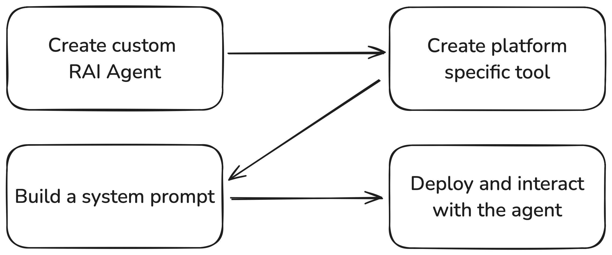

# RAI Walkthrough - from zero to a custom agent



## Overview

This guide demonstrates how to create and deploy a RAI agent on a ROS 2 enabled robot. You'll learn
how to:

1. Create a new, custom RAI Agent from scratch
2. Implement a platform-specific tool for robot control
3. Build a optimized system prompt using rai whoami
4. Deploy and interact with the agent

### Prerequisites

Before proceeding, ensure you have:

-   ROS 2 (humble or jazzy) installed and properly set up
-   RAI installed and configured

## Creating a Custom Agent

In this section, we'll create a new agent from scratch using the ReAct agent. While pre-built ROS
2-compatible agents exist in RAI, this example will help you understand the underlying architecture
and customization options.

The underlying ReAct agent combines language models with a set of tools to solve complex problems.
Our Agent implementation adds robot status monitoring, which controls agent execution based on the
robot's state.

```python title="PandaAgent implementation"
from typing import List

from langchain_core.messages import SystemMessage
from langchain_core.tools import BaseTool
from rai.agents import HRIOutput, ReActAgent, hri_connector_sender
from rai.communication import HRIMessage
from rai.communication.ros2 import ROS2Connector, ROS2HRIConnector


class PandaAgent(ReActAgent):
    def __init__(
        self,
        connector: ROS2Connector,
        tools: List[BaseTool],
        system_prompt: SystemMessage,
        input_topic: str,
        output_topic: str,
    ):
        # A ReAct agent with the provided tools and system prompt
        super().__init__(tools=tools, system_prompt=system_prompt)
        self.connector = connector

        # Initialize the ROS 2 HRI (Human-Robot Interface) connector
        # This handles bidirectional communication with human-facing topics
        self.hri_connector = ROS2HRIConnector()

        # Send what the agent says to the output topic
        self.subscribe(HRIOutput(hri_connector_sender(self.hri_connector, output_topic)))

        # Queue incoming human messages for the agent
        self.hri_connector.subscribe(input_topic, self.input_callback)

        # Monitor the robot's status topic to control agent execution
        # The agent will only process messages when the arm is ready
        self.arm_ready = False
        self.connector.subscribe("/panda_status", self.monitor_status_topic)

    def monitor_status_topic(self, msg):
        """Update the arm readiness status based on the status message."""
        self.arm_ready = msg.status == "ready"

    def input_callback(self, message: HRIMessage):
        """Process incoming messages when the arm is ready."""
        if self.arm_ready:
            self.submit(message)
        else:
            self.logger.warning("Arm is not ready, skipping the message")

    async def on_stop(self):
        """Clean up resources and close connections."""
        await super().on_stop()
        self.connector.close()
        self.hri_connector.close()

```

## Implementing Platform-Specific Tools

This section demonstrates how to implement a custom tool for safely shutting down the robot arm. The
tool showcases how to integrate platform-specific functionality into the RAI framework.

For comprehensive information about tool implementation in RAI, refer to the
[tools documentation](./tools.md).

```python title="Tools specific to the robot"
from typing import Literal, Type

from pydantic import BaseModel, Field
from rai.tools import Effect
from rai.tools.ros2.base import BaseROS2Tool

from rai_interfaces.srv import ShutdownArm


# Define the input schema for the tool
class ShutdownArmToolInput(BaseModel):
    level: Literal["soft", "hard"] = Field(
        default="soft",
        description="The level of shutdown to perform",
    )


# Define the tool
class ShutdownArmTool(BaseROS2Tool):
    """Tool for safely shutting down the robot arm."""
    default_effect = Effect.ACTUATE  # it moves hardware
    target_fields = {"service": "service"}
    name: str = "shutdown_arm"
    description: str = "Shutdown the arm"
    args_schema: Type[ShutdownArmToolInput] = ShutdownArmToolInput
    service: str = "/panda_arm/shutdown"

    async def _acall(self, level: Literal["soft", "hard"]) -> str:
        """Execute the arm shutdown command."""
        response = await self.connector.call(
            self.service, ShutdownArm.Request(level=level)
        )
        if response.success:
            return "Arm shutdown successful"
        else:
            return "Arm shutdown failed"
```

## Building the System Prompt

The `rai whoami` utility generates a system prompt based on your robot's specifications. It requires
a directory containing:

-   Documentation
-   Images
-   URDF files

!!! tip "Directories are optional"

    While each directory is optional, providing comprehensive
    information about your robot will result in a more accurate and effective system prompt.

For extended guide on `rai whoami` see [Create Robot's Whoami](./create_robots_whoami.md)

### Setting Up the Robot Directory

Create a `panda/` directory with the following structure:

1. **Images**

    - Save [this image](https://robodk.com/robot/img/Franka-Emika-Panda-robot.png) in `panda/images`

2. **Documentation**

    - Save
      [this document](https://github.com/user-attachments/files/16417196/Franka.Emika.Panda.robot.-.RoboDK.pdf)
      in `panda/documentation`

3. **URDF**
    - Save
      [this URDF](https://github.com/frankaemika/franka_ros/blob/develop/franka_description/robots/panda/panda.urdf.xacro)
      in `panda/urdf`

### Building the Whoami

Run the following command to build the whoami:

```bash
python src/rai_whoami/rai_whoami/build_whoami.py panda/ --build-vector-db
```

## Running the Agent

```python
import rai
from rai_whoami.models import EmbodimentInfo
from rai.communication.ros2 import ROS2Context, ROS2Connector
from rai.tools.ros2 import ROS2Toolkit


@ROS2Context()  # Initializes ROS 2 context and ensures proper cleanup on exit
def main():
    # Load the robot's embodiment information from the whoami directory
    whoami = EmbodimentInfo.from_directory("panda/")
    connector = ROS2Connector()

    # Initialize tools with ROS 2 communication capabilities
    # BaseROS2Tools require a ROS2Connector instance for communication
    tools = [
        ShutdownArmTool(connector=connector),
        *ROS2Toolkit(connector=connector).get_tools(),
    ]

    # Create and configure the agent with all necessary components
    agent = PandaAgent(
        connector=connector,
        tools=tools,
        system_prompt=whoami.to_langchain(),
        input_topic="/from_human",
        output_topic="/to_human",
    )

    # Run the agent until Ctrl+C
    rai.run(agent)

if __name__ == "__main__":
    main()
```

### Communicating with the Agent

The agent exposes two main communication channels:

1. **Sending Commands**

    ```bash
    ros2 topic pub /from_human rai_interfaces/msg/HRIMessage "{\"text\": \"Move the arm to 0, 0, 0?\"}"
    ```

2. **Receiving Responses**

    ```bash
    ros2 topic echo /to_human rai_interfaces/msg/HRIMessage
    ```
